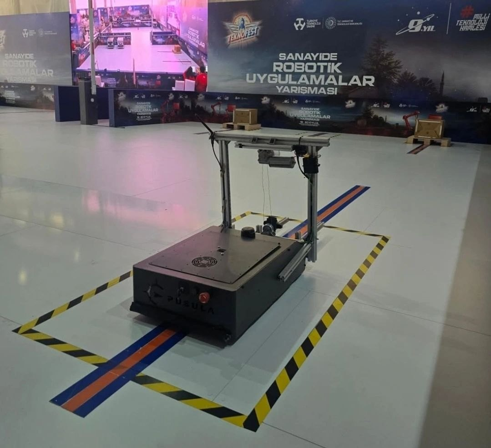
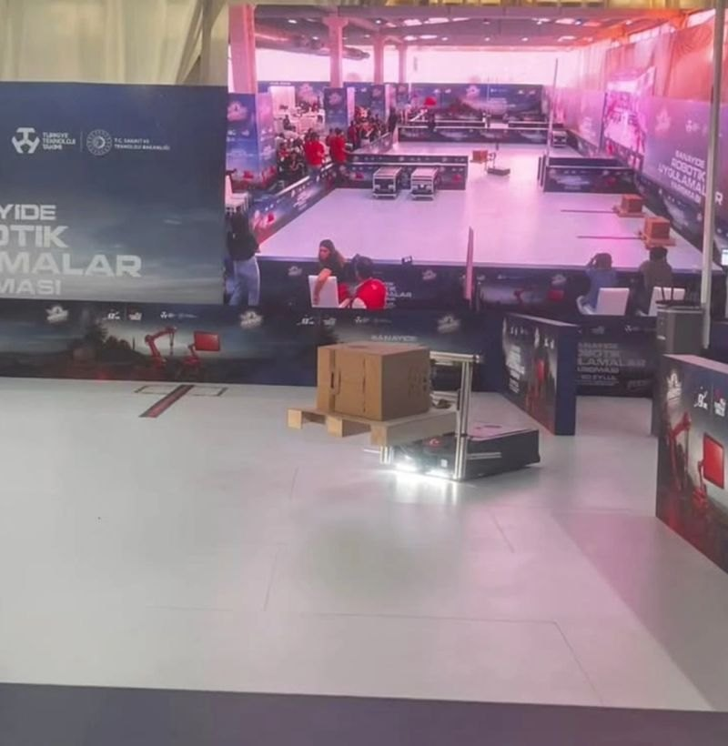

# SIRIUS AMR

PUSULA takımı olarak TEKNOFEST 2026 Sanayide Robotik Uygulamalar yarışması için
geliştirdiğimiz otonom mobil robot. Depo ve fabrika ortamlarında yük taşımak
üzere tasarlandı. Yarışmayı Türkiye 6.'sı olarak tamamladık ve görevi eksiksiz
bitiren takımlardan biri olduk.

## Robot

| | |
| --- | --- |
| Gövde | Çelik şasi |
| Algılama | RPLIDAR, IMU, tekerlek enkoderleri |
| Hesaplama | ROS 2 çalıştıran gömülü bilgisayar (Jetson, Raspberry Pi 5) |
| Alt seviye kontrol | Arduino Mega 2560 ile motor sürücüleri ve kaldırma sistemi |
| Güç | 8S LiFePO4 batarya paketi, akıllı BMS |
| Yük sistemi | Frenli DC motor ve kayış ile çalışan, 450 mm çatallı kaldırma mekanizması |

## Yazılım

Navigasyon ROS 2 ve Nav2 üzerine kurulu. LiDAR ile çıkarılan harita üzerinde
robot kendi konumunu buluyor, verilen hedefe giden rotayı planlıyor ve yol
üzerindeki engellerden kaçınıyor. Enkoder ve IMU verisi odometriyle birleştirilip
konum kestirimi iyileştiriliyor.

Kaldırma sistemi ve acil durdurma gibi alt seviye işler Arduino tarafında
yürüyor; ROS 2 ile aralarında seri haberleşme var. Böylece üst seviye yazılım
çökse bile acil durdurma çalışmaya devam ediyor.

## Takım

PUSULA, Bursa Teknik Üniversitesi.

| Rol | Kişiler |
| --- | --- |
| Takım kaptanı | Mehmet Furkan Ketme |
| Elektronik | Yusuf Düzenli, Netice Arsan |
| Mekanik | Hasan Eren Yazıcı, Oğuzhan Dursun |
| Yazılım | Furkan Karslı, Aslıhan Okumuş, Elif Beycan, Sude Çakmak |
| Danışman | Oğuz Mısır |

## Not

Bu depo robotun tanıtımı içindir. Kaynak kod takımın ortak deposunda tutuluyor
ve burada paylaşılmıyor.
